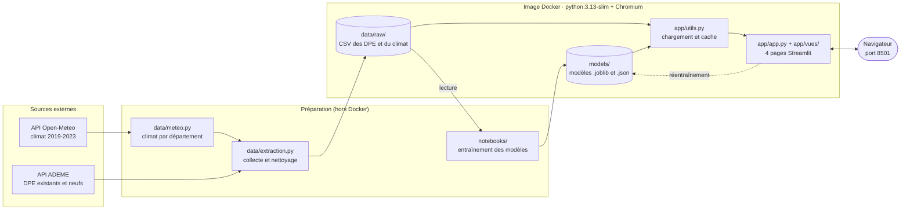

# Documentation technique – Application GreenTech DPE

## 1. Présentation

GreenTech DPE est une application web Streamlit (Python 3.13) qui prédit l'étiquette DPE et la consommation d'un logement. Elle est livrée sous la forme d'une image Docker qui contient le code, les modèles, les données et les dépendances.

## 2. Architecture



*Figure 1 – Architecture de l'application, de la collecte des données au navigateur*

**Préparation (hors de l'image).** `data/meteo.py` calcule le climat, `data/extraction.py` collecte et nettoie les DPE, puis les notebooks entraînent les modèles.

**Application (dans l'image).** `data/raw/` contient les données, `models/` les modèles entraînés, `app/app.py` gère la navigation entre les pages de `app/vues/`, et `app/utils.py` charge les données et les modèles une seule fois.

## 3. Installation avec Docker

**Prérequis :** Docker Desktop (Windows, macOS) ou Docker Engine (Linux), installé et démarré.

**Étape 1 – Construire l'image**, depuis le dossier du projet qui contient le fichier `Dockerfile` (quelques minutes la première fois) :

```bash
docker build -t greentech-dpe .
```

Si l'archive `greentech-dpe.tar` vous a été fournie, la commande `docker load -i greentech-dpe.tar` remplace cette étape.

**Étape 2 – Lancer le conteneur.**

```bash
docker run -d --name greentech-dpe -p 8501:8501 greentech-dpe
```

**Étape 3 – Ouvrir l'application** à l'adresse **http://localhost:8501**. Dans `docker ps`, le statut du conteneur passe de `health: starting` à `healthy` au bout d'environ 30 secondes.

**Commandes utiles**

| Besoin | Commande |
|---|---|
| Voir l'état du conteneur | `docker ps` |
| Suivre les journaux | `docker logs -f greentech-dpe` |
| Arrêter, puis relancer | `docker stop greentech-dpe`, puis `docker start greentech-dpe` |
| Le port 8501 est déjà utilisé sur le poste | `docker rm -f greentech-dpe`, puis `docker run -d --name greentech-dpe -p 8080:8501 greentech-dpe` et ouvrir http://localhost:8080 |
| Supprimer le conteneur | `docker rm -f greentech-dpe` |
| Conserver les modèles réentraînés | ajouter `-v greentech-models:/app/models` à la commande `docker run` |
| Partager l'image | `docker save -o greentech-dpe.tar greentech-dpe` |

Dans `-p 8080:8501`, le premier nombre est le port du poste et le second celui de l'application dans le conteneur. Si le nom `greentech-dpe` est déjà pris, supprimez d'abord l'ancien conteneur. Après une modification du code, reconstruisez l'image.

## 4. Installation sans Docker

Pour modifier le code, depuis le dossier du projet (Python 3.13 requis) :

```bash
python -m venv .venv
source .venv/bin/activate              # Windows : .venv\Scripts\activate
pip install -r requirements.txt        # collecte des données et notebooks
pip install -r app/requirements.txt    # application web
streamlit run app/app.py               # puis ouvrir http://localhost:8501
```

## 5. Packages nécessaires

| Fichier | Packages | Utilisation |
|---|---|---|
| `models/requirements.txt` | numpy 2.1.3, pandas 2.2.3, scikit-learn 1.6.1, joblib 1.6.0 | Préparation des données, modèles |
| `app/requirements.txt` | streamlit 1.66.1, plotly 7.1.0, kaleido 1.5.0, plus ceux de `models/requirements.txt` | Interface web, graphiques, export PNG |
| `requirements.txt` | requests, prince, matplotlib et les packages de `models/` | Collecte des données et notebooks |
| `notebooks/requirements-classification.txt` | catboost 1.2.10, lightgbm 4.6.0 | Comparaison des modèles de classification |
| `Dockerfile` | image python:3.13-slim, Chromium | Exécution et export des graphiques |

Les modèles ont été enregistrés avec scikit-learn 1.6.1 : une autre version de scikit-learn impose de les réentraîner.
