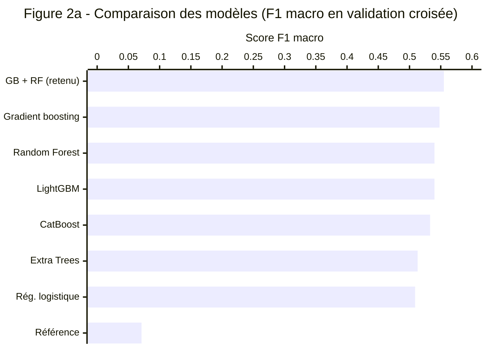
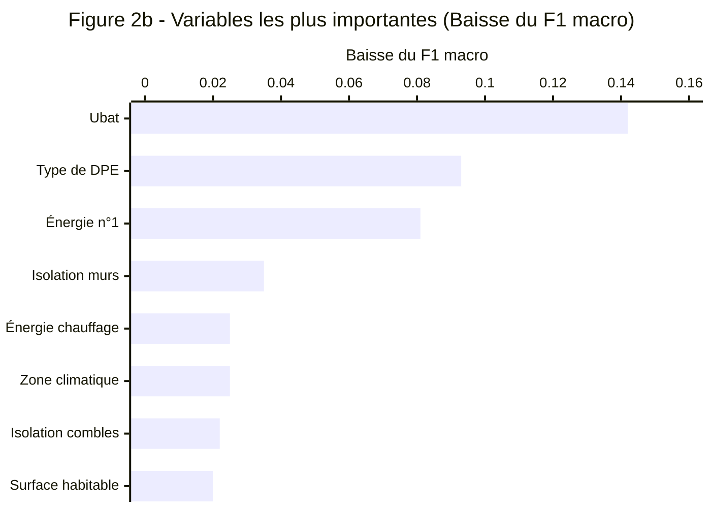
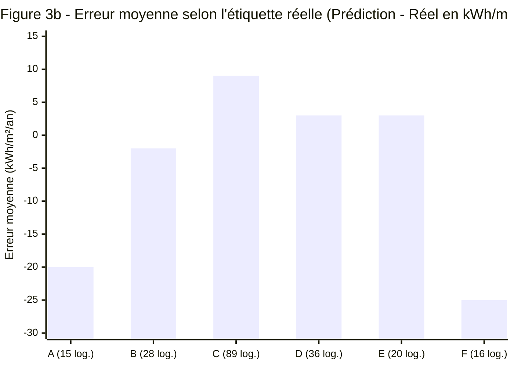

# Prédiction de l'étiquette DPE et de la consommation énergétique des logements

Rapport d'étude 

---

## 1. Contexte et objectifs

La loi Climat et Résilience interdit progressivement la location des logements les plus énergivores : les logements classés **G** depuis 2025, puis les **F** en 2028 et les **E** en 2034. Dans ce contexte, Enedis souhaite mieux comprendre le lien entre l'étiquette du diagnostic de performance énergétique (DPE) et la consommation d'énergie des logements.

Nous avons développé deux modèles de machine learning, intégrés dans une application web :

* **Modèle de classification :** prédit l'étiquette DPE d'un logement à partir de ses caractéristiques et la retrouve à une classe près dans **96 %** des cas.
* **Modèle de régression :** estime sa consommation par $\text{m}^{2}$ à partir de dix informations connues du propriétaire, avec une erreur moyenne de **$22\text{ kWh/m}^{2}\text{/an}$**.

L'étude montre également que l'étiquette ne dit pas tout : à partir de la classe D, un logement chauffé à l'électricité consomme **35 à 42 %** d'énergie en moins qu'un logement au gaz de même classe.

---

## 2. Données

### 2.1 Sources

Les DPE des logements existants et neufs proviennent de l'API de l'ADEME et sont déjà géocodés grâce à la Base Adresse Nationale (BAN). Nous y avons ajouté des données climatiques issues d'Open-Meteo : pour chaque département, les degrés-jours unifiés (DJU) et les températures moyennes d'hiver et d'été sur la période 2019–2023.

La classification demandant beaucoup plus d'exemples que la régression, nous avons constitué deux jeux de données distincts :

* **Jeu de régression et d'analyse :** **683 logements** (498 existants, 185 neufs), utilisé pour les indicateurs clés et le modèle de consommation.
* **Jeu de classification :** **19 506 logements** (9 681 existants, 9 825 neufs), réservé au modèle de prédiction de l'étiquette DPE.

### 2.2 Préparation

Pour le jeu de 683 logements, nous avons supprimé les doublons, conservé les colonnes communes aux DPE existants et neufs, puis retiré les colonnes vides à plus de 70 % et les lignes vides à plus de 30 %. Les autres valeurs manquantes ont été imputées séparément pour l'existant et le neuf : par la méthode des plus proches voisins (**KNN**) pour les variables numériques, et par la valeur la plus fréquente (**mode**) pour les variables qualitatives.

Les données climatiques couvrent 604 logements (88 %). Pour le jeu de classification, nous avons exclu 494 diagnostics portant sur des immeubles entiers.

---

## 3. Indicateurs clés (KPI)

**Tableau 1 — Indicateurs clés sur les 683 logements (en énergie finale, livrée au logement)**

| Indicateur | Valeur | Détail |
| :--- | :--- | :--- |
| **Départements représentés** | 83 | Calvados : 11 % des logements |
| **Consommation médiane** | $101\text{ kWh/m}^{2}\text{/an}$ | 130 pour l'existant, 53 pour le neuf |
| **Coût annuel médian** | 942 € | 1 212 € pour l'existant, 453 € pour le neuf |
| **Passoires thermiques (F et G)** | 6,3 % | 8,6 % de l'existant (12,7 % en France en 2025) |
| **Chauffage électrique** | 42,6 % | 60,5 % des passoires thermiques |

### 3.1 Consommation selon l'étiquette

**Tableau 2 — Consommation et coût médians selon l'étiquette DPE**

| Métrique | A | B | C | D | E | F | G |
| :--- | :---: | :---: | :---: | :---: | :---: | :---: | :---: |
| **Logements** | 63 | 87 | 264 | 134 | 92 | 36 | 7 |
| **Énergie finale** ($\text{kWh/m}^{2}\text{/an}$) | 22 | 51 | 83 | 154 | 226 | 253 | 403 |
| **Énergie primaire** ($\text{kWh/m}^{2}\text{/an}$) | 42 | 74 | 113 | 210 | 283 | 385 | 564 |
| **Coût annuel** (€) | 423 | 529 | 798 | 1 552 | 1 533 | 2 647 | 3 244 |

La consommation augmente nettement d'une classe à l'autre : elle double presque entre C et D, et un logement G consomme environ 18 fois plus qu'un logement A. L'écart entre E et F est pourtant faible ($27\text{ kWh/m}^{2}\text{/an}$), et un logement E coûte autant qu'un logement D. Ces irrégularités viennent du mode de calcul de l'étiquette, qui repose sur l'énergie primaire et les émissions de gaz à effet de serre, et non sur l'énergie réellement consommée dans le logement.

### 3.2 Le rôle de l'énergie de chauffage

```mermaid
xychart-beta
    title "Figure 1 - Consommation médiane : Gaz naturel vs Électricité (kWh/m²/an)"
    x-axis ["B (32/38)", "C (157/74)", "D (55/57)", "E (34/44)", "F (10/23)"]
    y-axis "Consommation (kWh/m²/an)" 0 --> 400
    bar [48, 82, 185, 267, 342]
    bar [49, 76, 121, 154, 216]
```

> **Légende Figure 1 :** Première série = **Gaz naturel** | Deuxième série = **Électricité**.  
> Écarts de l'électricité par rapport au gaz : **-35 %** en classe D, **-42 %** en classe E et **-37 %** en classe F.

Pour les étiquettes B et C, les logements chauffés au gaz et à l'électricité consomment autant (Figure 1). À partir de D, en revanche, un logement électrique consomme **35 à 42 %** d'énergie en moins qu'un logement au gaz de même étiquette. L'étiquette est en effet calculée en énergie primaire, qui vaut $1,9$ fois l'énergie finale pour l'électricité depuis le 1er janvier 2026. Pour Enedis, elle ne traduit donc pas directement la consommation mesurée au compteur et doit être lue avec l'énergie de chauffage.

Le climat joue un rôle secondaire. La corrélation de Spearman entre la consommation et les DJU n'est que de $0,24$, contre $-0,66$ avec l'année de construction et $0,67$ avec l'$U_{bat}$, le coefficient qui mesure les pertes de chaleur de l'enveloppe du bâtiment.

---

## 4. Méthodologie

### 4.1 Classification de l'étiquette DPE

* **Variables :** Le modèle utilise 31 variables décrivant le logement : surface, année de construction, $U_{bat}$, zone climatique, énergies, équipements, qualité de l'isolation, etc. Les consommations, les émissions et les coûts sont exclus : avec eux, le modèle recalculerait le DPE au lieu de le prédire.
* **Découpage :** Plusieurs DPE peuvent concerner un même immeuble. Pour éviter que deux appartements voisins se retrouvent l'un en apprentissage et l'autre en test, nous avons regroupé les diagnostics par bâtiment ou par adresse. Les 12 180 groupes ont été répartis entre l'apprentissage (15 615 logements) et le test (3 891), puis sept algorithmes ont été comparés par validation croisée à quatre plis respectant ces groupes.

### 4.2 Régression de la consommation

* **Variable à prédire et préparation :** La cible est la consommation d'énergie finale par $\text{m}^{2}$ et par an pour les cinq usages du DPE. Le jeu de 683 logements est découpé en 70 % d'apprentissage et 30 % de test. Les variables ordonnées (étiquettes, qualité de l'isolation) sont codées selon leur rang et les autres variables qualitatives en indicatrices ; les valeurs manquantes sont remplacées par la médiane de l'apprentissage, puis les variables sont standardisées.
* **Deux jeux de variables :** Nous avons d'abord utilisé toutes les variables disponibles, climat compris (1 772 colonnes après encodage), puis un jeu « propriétaire » limité à dix informations significatives dans la régression MCO et connues d'un particulier : étiquettes DPE et GES, isolation des murs, logement traversant ou non, nombre de niveaux de l'immeuble, installation et énergie du chauffage et de l'eau chaude, et zone climatique.
* **Modèles :** Pour chaque jeu, nous avons comparé une régression linéaire classique (MCO) et trois régressions pénalisées (Ridge, Lasso et Elastic Net), dont les paramètres sont choisis par validation croisée à cinq plis. Une analyse des correspondances multiples (ACM) sur les variables qualitatives n'a fait ressortir aucun axe exploitable. Le modèle retenu a ensuite été réentraîné sur les 683 logements.

### 4.3 Métriques d'évaluation

**Tableau 3 — Métriques utilisées (en gras, le critère de choix du modèle)**

| Modèle | Métrique | Ce qu'elle mesure |
| :--- | :--- | :--- |
| **Classification** | **F1 macro** | Moyenne des F1 par classe, à poids égal |
| | Accuracy | Part des étiquettes exactes |
| | À une classe près | Part des erreurs d'au plus une classe |
| | Kappa quadratique | Accord avec la réalité, de $0$ (hasard) à $1$ |
| **Régression** | **RMSE (VC)** | Erreur quadratique en validation croisée |
| | MAE | Erreur absolue moyenne, en $\text{kWh/m}^{2}\text{/an}$ |
| | $R^{2}$ | Part de la variance expliquée |

Le F1 macro est préféré à l'accuracy car les classes A, F et G sont rares parmi les logements existants. L'écart d'une classe et le kappa tiennent compte de l'ordre des étiquettes.

---

## 5. Résultats et interprétation des modèles

### 5.1 Classification de l'étiquette DPE

Tous les modèles font bien mieux que la référence, qui prédit toujours la classe la plus fréquente (Figure 2a). Le gradient boosting est le meilleur sur les logements existants et le Random Forest sur les neufs : le modèle retenu combine les deux, pour un gain modeste ($0,7$ point de F1) et une accuracy de $66,1\text{ \%}$ en validation croisée.

**Tableau 4 — Résultats sur l'échantillon de test (3 891 logements)**

| Métrique | Référence | Modèle retenu |
| :--- | :---: | :---: |
| **Accuracy** | 34,9 % | **65,8 %** |
| **F1 macro** | 0,074 | **0,553** |
| **À une classe près** | 63,6 % | **95,8 %** |
| **Kappa quadratique** | 0,000 | **0,887** |

**Interprétation :** Sur des logements qu'il n'a jamais vus, le modèle trouve la bonne étiquette deux fois sur trois et se trompe d'au plus une classe dans 96 % des cas ; le kappa de $0,89$ confirme que ses erreurs portent presque toujours sur une classe voisine. Il est plus précis pour le neuf (76 % d'étiquettes exactes, sur trois classes seulement) que pour l'existant (56 %), dont le DPE dépend de détails absents des données, comme le rendement du chauffage. La classe A est très bien reconnue (F1 de $0,88$), alors que les classes rares sont plus difficiles à prédire, en particulier F ($0,37$).

L'importance des variables, mesurée par permutation sur le gradient boosting (Figure 2b), place nettement l'$U_{bat}$ en tête, devant le type de DPE, l'énergie n° 1 du logement et l'isolation des murs. Ce classement est cohérent avec la méthode de calcul du DPE : sans l'$U_{bat}$, la prédiction est nettement moins fiable.

### 5.2 Régression de la consommation

**Tableau 5 — Comparaison des modèles de régression (erreurs en $\text{kWh/m}^{2}\text{/an}$ ; en gras, le modèle retenu)**

| Variables | Modèle | RMSE (VC) | MAE (test) | RMSE (test) | $R^{2}$ (test) |
| :--- | :--- | :---: | :---: | :---: | :---: |
| **Toutes (1 772)** | MCO | — | 4,7 | 9,3 | 0,986 |
| | Ridge | 35,9 | 23,8 | 42,1 | 0,709 |
| | Lasso | 11,4 | 4,4 | 8,2 | 0,989 |
| | Elastic Net | 21,9 | 11,9 | 20,8 | 0,929 |
| **Propriétaire (10)** | MCO | — | 22,0 | 28,5 | 0,867 |
| | Ridge | 35,6 | 22,2 | 28,1 | 0,870 |
| | Lasso | 35,6 | 22,0 | 27,4 | 0,876 |
| | **Elastic Net** | **35,6** | **22,2** | **28,1** | **0,870** |

**Pourquoi écarter les modèles complets ?** Le meilleur d'entre eux, le Lasso, atteint un $R^{2}$ de $0,989$, mais ce score est trompeur : le jeu complet contient l'énergie primaire et les émissions par $\text{m}^{2}$, presque proportionnelles à la variable à prédire. Ces modèles lisent la réponse au lieu de l'apprendre, et ils seraient inutilisables par un particulier.

> **Note sur la Figure 3a (Consommation prédite et réelle sur les 205 logements du test) :** Les points suivent fidèlement la diagonale de prédiction parfaite entre $0$ et $400\text{ kWh/m}^{2}\text{/an}$.

**Le modèle retenu :** Sur le jeu « propriétaire », les trois régressions pénalisées sont presque à égalité : l'**Elastic Net** ($\alpha = 0,023$, ratio $L1 = 0,2$) est retenu de justesse sur la RMSE en validation croisée, critère fixé avant le test. Son erreur moyenne est de $22\text{ kWh/m}^{2}\text{/an}$, contre $60$ en prédisant la moyenne pour tous les logements, et 57 % des prédictions sont à moins de 20 % de la valeur réelle. Les points suivent bien la diagonale (Figure 3a), mais les extrémités sont sous-estimées : de $20\text{ kWh/m}^{2}\text{/an}$ en moyenne pour les logements A et de $25$ pour les logements F (Figure 3b). Deux logements A reçoivent même une prédiction négative, un défaut propre aux modèles linéaires.

**Interprétation :** Les coefficients les plus forts portent sur les étiquettes GES et DPE, puis sur les énergies du chauffage et de l'eau chaude et sur l'isolation des murs. L'étiquette DPE explique à elle seule 75 % de la variance de la consommation, et 83 % avec l'étiquette GES. Toutes choses égales par ailleurs, une classe DPE supplémentaire correspond à environ $27\text{ kWh/m}^{2}\text{/an}$ de plus, soit près de $1\,800\text{ kWh}$ par an pour un logement de $67\text{ m}^{2}$ (la surface médiane). Une classe GES supplémentaire ajoute environ $31\text{ kWh/m}^{2}\text{/an}$ : à étiquette DPE égale, un logement qui émet beaucoup est chauffé avec une énergie fossile et consomme davantage. Enfin, chaque niveau de qualité d'isolation des murs en plus réduit la consommation d'environ $8\text{ kWh/m}^{2}\text{/an}$.

---

## 6. Limites et pistes d'amélioration

* **Une consommation calculée, et non mesurée.** La cible est la consommation théorique du DPE, parfois loin de la consommation réelle.
* **Un échantillon peu représentatif.** Le Calvados est surreprésenté, et la part de passoires est deux fois plus faible qu'en France.
* **Une imputation réalisée avant le découpage.** Elle crée une légère fuite d'information et des valeurs incohérentes ($0,4$ pour « logement traversant », qui vaut $0$ ou $1$).
* **Un test déjà consulté et peu de données.** Le test de la classification a servi pendant le développement, et la régression ne repose que sur 683 logements.

Pour aller plus loin, il faudrait tirer un échantillon plus grand et au hasard dans l'API, imputer après le découpage, affiner les hyperparamètres, ajouter la surface, l'année de construction et le type de logement au modèle « propriétaire », et comparer les consommations du DPE à celles mesurées par Enedis.

---

## Conclusion

L'étiquette DPE est bien liée à la consommation, mais elle doit être lue avec l'énergie de chauffage : à partir de la classe D, un logement électrique consomme bien moins qu'un logement au gaz de même classe. Le premier modèle retrouve l'étiquette à une classe près dans 96 % des cas, et le second estime la consommation à $22\text{ kWh/m}^{2}\text{/an}$ près en moyenne, à partir de dix informations simples. Leur principale limite vient de l'échantillon, qu'il faudrait élargir et tirer au hasard.

### Sources

* ADEME, observatoire des DPE
* Base Adresse Nationale (BAN)
* Open-Meteo
* SDES-ONRE, parc de logements par classe de DPE au 1er janvier 2025
* Arrêté du 13 août 2025 relatif au coefficient de conversion de l'électricité
